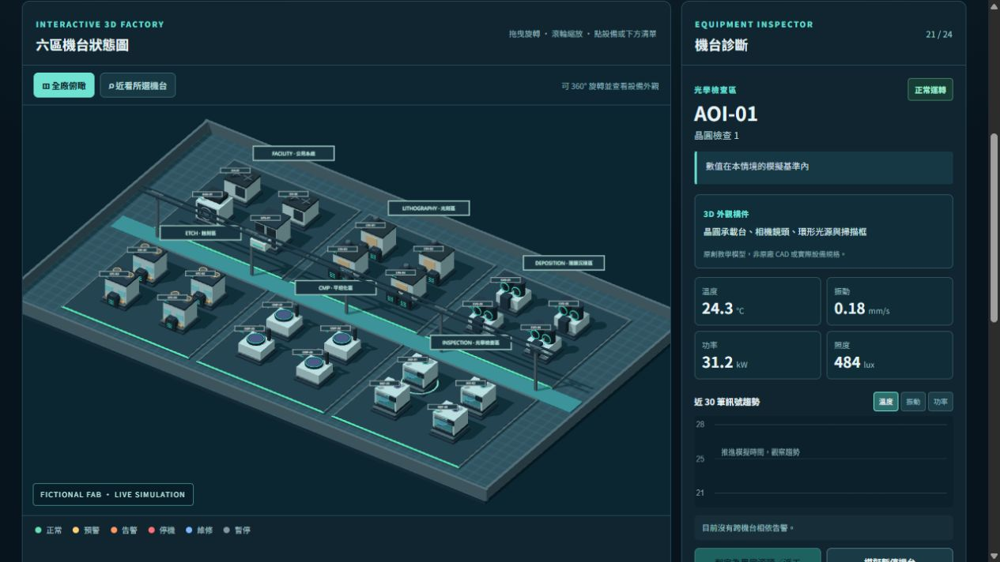
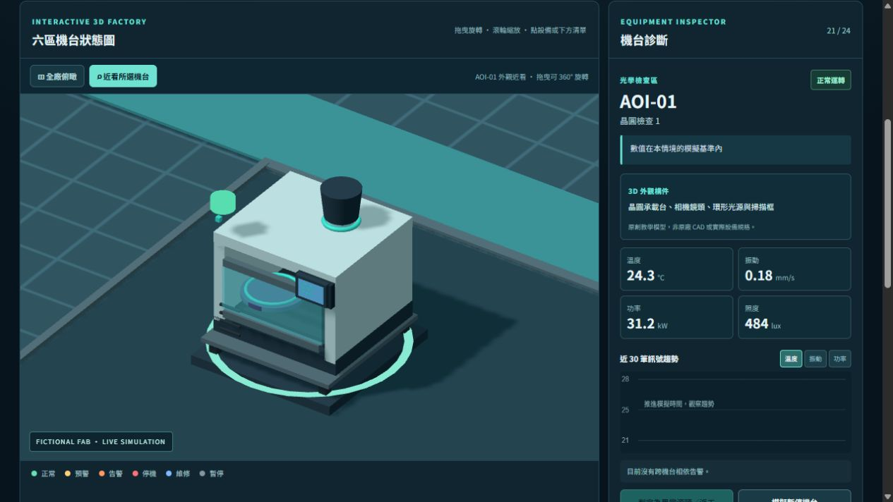
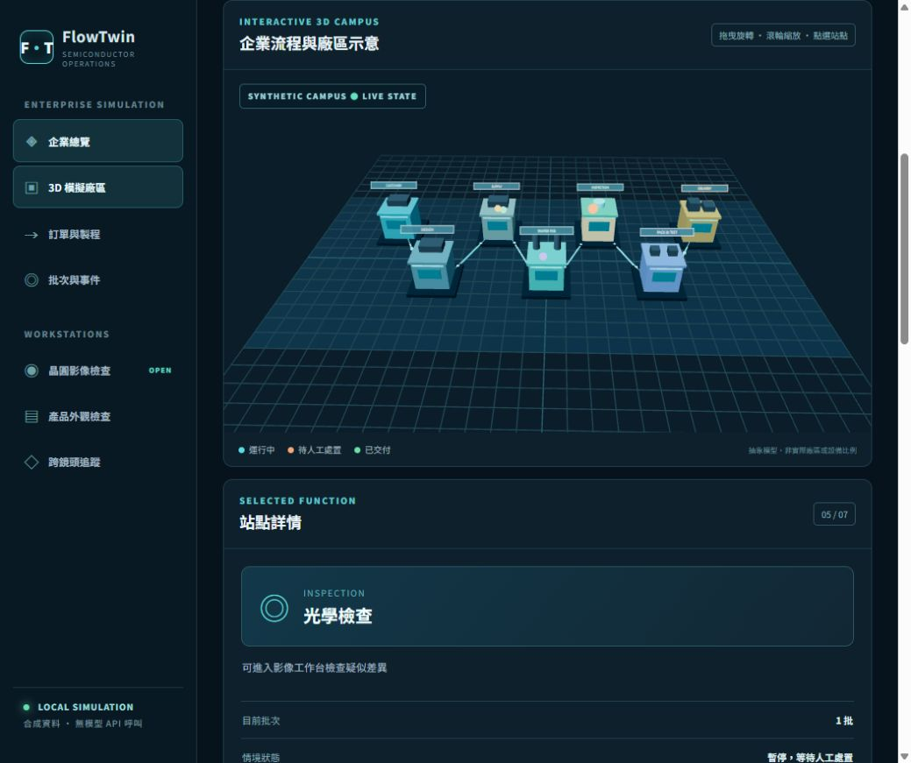
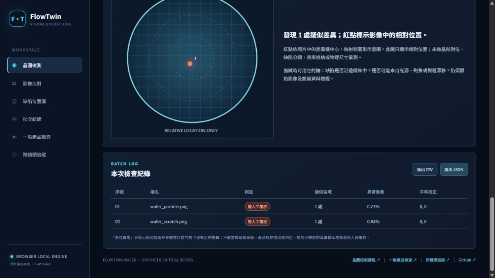
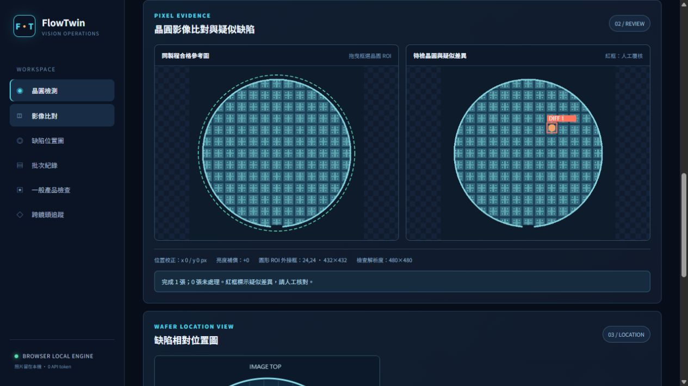
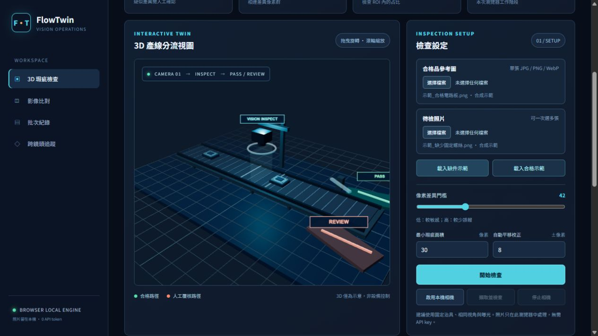
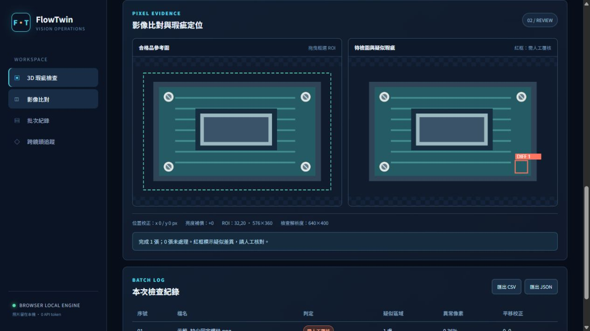

# FlowTwin Enterprise｜半導體企業流程與晶圓視覺檢查模擬

**[開啟 3D 整廠機台監控](https://a25253614611.github.io/factory-vision-twin/monitor.html)** · [監控使用與面試指南](MONITOR_GUIDE.md) · [企業總覽](https://a25253614611.github.io/factory-vision-twin/) · [光學工程師值班練習](https://a25253614611.github.io/factory-vision-twin/aoi-shift.html) · [值班遊戲 7 天課](SHIFT_COURSE.md) · [晶圓檢測工作台](https://a25253614611.github.io/factory-vision-twin/wafer.html) · [一般產品檢查](https://a25253614611.github.io/factory-vision-twin/assembly.html) · [跨鏡頭追蹤](https://a25253614611.github.io/factory-vision-twin/tracking.html)

## 3D 整廠設備監控

新主頁 `monitor.html` 有六個虛構廠區、24 台可點選設備：公用系統、光刻、薄膜沉積、蝕刻、平坦化與光學檢查。3D 地圖、六區熱區卡、機台表和詳細訊號都讀取同一個可測試的狀態。可按 5／30 分鐘推進，或自動播放，觀察溫度、振動、功率、照度、估計處理量、狀態及時間趨勢。三種異常情境會跨區影響其他機台：冷卻迴路漂移、蝕刻振動、檢查照明波動。玩家根據相依關係判定源頭、派出**模擬**維修，再觀察其他機台恢復。搜尋、區域與狀態篩選可用來快速檢視全廠。估計線速取製程區中最小處理能力，避免直接加總同一晶圓在多站的通過量。

24 台設備現在依九種用途使用原創的參數化 3D 外觀：冷卻機、空調箱、備援電源、光刻機、沉積腔、蝕刻腔、研磨機、AOI 與量測台。點選後按「近看所選機台」，或雙擊 3D 設備，可隔離模型並 360° 旋轉，查看風扇、管線、腔體、載具埠、研磨盤或光學承載台等構件。共用幾何可降低重複配置；只有近看的機台顯示小零件，畫面外會暫停繪製。這些都是教學用外觀模型，並非設備製造商的 CAD、尺寸或內部機構。

| 全廠俯瞰 | AOI 機台近看 |
| --- | --- |
|  |  |

舊 `shift.html` 會轉到監控頁；原本的單一無塵室練習保留於 `aoi-shift.html`。這些訊號都是決定性的合成範例，沒有讀取真實台積電設備、MES、SCADA、PLC 或 IoT 資料，也沒有遠端控制。瀏覽器本機運作時沒有模型 API 呼叫。若要監控真實工廠，仍需業主授權的資料接口、時戳／設備 ID 對應、權限、稽核與現場驗證。詳見[監控使用與面試指南](MONITOR_GUIDE.md)。

## 3D 光學檢查工程師值班（可玩版本）

在原創 Three.js 無塵室中控制工程師，走訪載具交接、製程履歷、AOI、品質處置與交班五個站點。可用 WASD／方向鍵、螢幕方向按鈕，或點選站點自動前往。三種合成情境為疑似微粒、照明波動與正常批次；AOI 使用本專案既有的影像比對核心實際運算，再由玩家決定暫停或放行，最後下載交班 JSON。約三分鐘可完成一次值班。此作品沒有複製 [fab24hr](https://fab24hr.com/) 的程式或素材，場景、人物與設備均由程式自行建模；現場參數和程序都是虛構的。詳見[每天兩小時的 7 天課程](SHIFT_COURSE.md)。

## 公司層級展示

首頁是一個**可操作、完全虛構**的半導體企業流程模擬。3D 廠區與批次表呈現七個功能：客戶訂單、設計協作、材料供應、晶圓製造、光學檢查、封裝測試、交付物流。另有客戶／BD、製程工程、設備／廠務與品質的支援視角。可以每次推進 1 或 8 個模擬小時，切換「正常運行」「疑似微粒」「設備停機」「急單插入」，觀察暫停、人工處置、返工、交期與事件紀錄。瀏覽器工作階段會保留總覽進度，方便進入影像頁再返回。`enterprise-core.js` 是可測試的決定性狀態機；`enterprise-ui.js` 顯示指標與批次；`enterprise-3d.js` 將相同狀態投影到 Three.js 抽象廠區。

這個「公司」不是台積電的組織、廠區或 MES 複製品。客戶、批次、時程和營運數字都是合成資料；沒有內部資料、真實產線、設備或供應鏈連線，也不預測真實交期、良率或產能。公開資料只支持展示選擇了哪些跨部門環節：[台積電製造介紹](https://www.tsmc.com/english/dedicatedFoundry/manufacturing)、[智慧營運](https://www.tsmc.com/english/dedicatedFoundry/manufacturing/intelligent_operations)、[智慧封裝廠](https://www.tsmc.com/english/dedicatedFoundry/services/apm_intelligent_packaging_fab)。作品與台積電無關聯。



### 兩分鐘展示流程

1. 在首頁選「疑似微粒」，按「推進 8 小時」，觀察批次在光學檢查暫停；在 3D 或流程列點選檢查站。
2. 開啟[晶圓影像檢查工作台](https://a25253614611.github.io/factory-vision-twin/wafer.html)，點「微粒示範」，看合成影像的疑似差異框與相對位置圖。
3. 回總覽按「覆核後返工」，觀察批次退回製造站，再推進時間直到交付。說明此情境的 BD 問題：誤報成本、人工覆核量、返工時間與交期風險。
4. 若面試官問到可否現場使用，說明下一步需要授權資料、MES／相機介面、告警規則和真實批次回放驗證；現版僅是瀏覽器 PoC。

啟動與檢查：`py -3 -m http.server 8766 --bind 127.0.0.1`，開啟 <http://127.0.0.1:8766/>；`npm test`、`py -3 -m unittest -q`。前端沒有模型 API 呼叫，操作模擬時模型 token 用量為零。

## 晶圓視覺檢查工作台

以「晶圓製程後光學檢查」為面試場景的**公開資料原型**。主頁包含可旋轉的 3D 製程檢查站、合成晶圓的微粒／刮痕／良品示範、圓形 ROI 參考圖比對、疑似差異標框、相對位置圖與批次匯出。使用者也能上傳固定視角、同製程層的自有照片。照片在瀏覽器本機處理，執行時不呼叫模型 API。

| 3D 晶圓檢查站 | 微粒示範與標框 |
| --- | --- |
|  |  |

**範圍說明：**本專案沒有台積電內部影像、機台參數、製程規格或設備連線，也不宣稱與台積電合作。公開資料僅用來選擇合理的教學場景。這個原型做的是固定視角參考圖差異提示，無法檢測奈米尺度、推估良率或自動決定晶圓合格。3D 是製程狀態示意，不是與實體同步的數位孿生。[半導體產業協會的製程介紹](https://www.semiconductors.org/semiconductors-101/how-are-semiconductors-made/stage-3-front-end-manufacturing/)說明了沉積、蝕刻和量測檢查在製造流程中的角色；[台積電 2025 年報](https://investor.tsmc.com/static/annualReports/2025/english/pdf/2025_tsmc_ar_e_ch5.pdf)提到電腦視覺用於晶圓瑕疵檢查，但本作品不重現其系統。

## 晶圓版使用方式

1. 線上先按「微粒示範」「刮痕示範」「良品示範」，比較標框、相對位置圖與 3D REVIEW／PASS 路徑。示範影像由 `sample_images/generate_wafer.py` 產生，並非真實晶圓。
2. 使用自己的照片時，先上傳同製程層、相同相機視角和照明下的合格參考圖，再上傳待檢圖。待檢圖最多 25 張，單張 20 MB 以下，格式為 JPG／PNG／WebP。晶圓需置中；可在參考圖拖曳 ROI 外接框。
3. 系統以小範圍平移校正、全域亮度補償、圓形遮罩、像素門檻和相連差異區域找出疑似位置。調整門檻後重跑；CSV／JSON 匯出含框座標與參數，但不含原始照片。
4. 記錄誤報與漏檢，請人工覆核。上線前須用取得授權的真實影像，分製程層、缺陷類型、機台、批次與光線條件驗證。

本機啟動：在 repo 目錄執行 `py -3 -m http.server 8766 --bind 127.0.0.1`，開啟 <http://127.0.0.1:8766/wafer.html>。前端不需 `npm install`；Three.js 已置於 `vendor/three/`。程式測試：`npm test` 與 `py -3 -m unittest -q`。

## 參考工具的取捨

- [jyax/3d-factory-digital-twin](https://github.com/jyax/3d-factory-digital-twin)展示 3D 資產監控與即時資料架構，原專案使用 Orillusion、Vue、MQTT、MongoDB。此作品只參考展示思路，未複製其程式或引入伺服器堆疊。
- [Online3DViewer](https://github.com/kovacsv/Online3DViewer)可檢視 STEP、IFC、glTF 等模型；未來若有**授權的 CAD 資產**可用於預覽。本版模型由 Three.js 程式生成，沒有必要額外載入 CAD viewer。
- [three.signal-line](https://github.com/Tankerxyz/three.signal-line)可繪製流動訊號線。本版僅需簡單搬運動線，因此用原有 Three.js 動畫實作，減少載入依賴。

## 一般產品檢查（保留）

**[開啟一般產品檢查](https://a25253614611.github.io/factory-vision-twin/assembly.html)** · [通用檢查 7 天課](INSPECTION_COURSE.md) · [跨鏡頭追蹤四週課](COURSE.md)

給固定相機、固定產品姿態的初步瑕疵檢查使用。提供合格品參考圖與待檢照片後，瀏覽器會做位置校正、全域亮度補償、ROI 內的像素差異比對，以及相連差異區域標框。可批次檢查最多 25 張、匯出 CSV／JSON，或在允許相機權限後擷取照片。檢查結果會驅動可旋轉、縮放的 Three.js 3D 產線分流示意。

| 3D 產線示意 | 缺件標框與人工覆核 |
| --- | --- |
|  |  |

**這是可操作的影像檢查原型，不是已驗證的工業自動判退系統。** 它沒有神經網路、深度相機、PLC／MES 連線或真實設備控制。「未見異常」只代表在目前設定下與參考圖沒有足夠差異；「需人工覆核」也可能是光線、角度或反光造成。3D 是檢查站的視覺化，不會從照片重建產品的 3D 幾何。

### 立即使用

線上版可直接按「載入缺件示範」，看到缺少固定螺絲的合成範例。接著按「載入合格示範」比較結果。頁面部署在 GitHub Pages；執行影像比對時不呼叫模型 API，因此**執行時模型 token 用量為 0**。照片由瀏覽器本機讀取與處理，不上傳到本專案的伺服器；只有使用者主動匯出的 CSV／JSON 會存到自己的裝置。

在本機執行只需 Python 3.10+：

```powershell
py -3 -m http.server 8766 --bind 127.0.0.1
```

開啟 <http://127.0.0.1:8766/assembly.html>。不要直接雙擊 HTML，瀏覽器的 ES module 與相機安全限制可能讓功能失效。沒有 `py` 時可用 `python -m http.server 8766 --bind 127.0.0.1`。**不需要執行 `npm install` 才能使用網頁**：Three.js 0.186.1 已放在 `vendor/three/`，頁面沒有執行時 CDN 依賴。

### 用自己的照片

1. 用固定治具把同一款產品放在相同位置、相同方向；盡量鎖定曝光與光源。先拍一張確認合格的參考圖。
2. 拍待檢品，讓背景、鏡頭距離和裁切範圍一致。支援 JPG、PNG、WebP；單張上限 20 MB，待檢圖與參考圖長寬比差距須在 3% 內。
3. 上傳合格品參考圖，再選最多 25 張待檢照片，按「開始檢查」。可在參考圖上拖曳選定產品區域 ROI，避開移動背景。
4. 檢視紅框、平移與亮度補償值，人工確認疑似差異；調整像素門檻與最小瑕疵面積後可重跑。批次記錄可匯出 CSV／JSON，不含原始影像像素。
5. 若用「啟用本機相機」，瀏覽器會詢問相機權限；先上傳參考圖，將產品放入相同視角，再按「擷取並檢查」。相機在停止或離開頁面時關閉。[MDN 的 getUserMedia 文件](https://developer.mozilla.org/en-US/docs/Web/API/MediaDevices/getUserMedia)說明了相機權限與 HTTPS／localhost 安全環境要求。

`sample_images/reference.png` 與 `sample_images/missing_fastener.png` 是**本專案生成的合成照片**，可練習實際檔案上傳流程。重新生成：`py -3 sample_images/generate.py`。

### 系統流程

```text
合格品參考圖 + 待檢照／相機擷取
            ↓
縮至最長邊 640 px → ROI → 邊緣搜尋小範圍平移
            ↓
全域亮度中位數補償 → RGB 像素差異門檻
            ↓
相連差異區域 + 最小面積 → 人工覆核／未見異常
            ↓
標框 + 批次紀錄 + CSV／JSON + 3D 分流示意
```

- `inspection-core.js`：純 JavaScript 比對演算法；不讀檔案名稱、標籤或真值。
- `inspection-ui.js`：上傳、相機、ROI、參數、標框、匯出與狀態。
- `factory-3d.js`：Three.js 產線示意，根據每張照片的檢查結果切換路徑。
- `assembly.html`、`inspection.css`：一般產品檢查工作台；`wafer.html` 是晶圓檢查頁，`index.html` 是企業總覽。
- `tracking.html`、`app.js`、`simulate.py`：原有跨鏡頭在製品追蹤概念模擬器；其資料與延遲指標全部為合成值。

### 驗證與界線

```powershell
npm test
py -3 -m unittest -q
```

`npm test` 使用 Node.js 內建測試器檢查瑕疵定位、光線補償、平移校正、ROI 與錯誤輸入；Python 測試驗證原有追蹤模擬。執行網頁不需要 Node.js，Node.js 只用於檢查程式。已在瀏覽器實測合成範例的實際上傳、比對與 3D 顯示。**尚未用客戶的真實產線資料、特定相機或邊緣設備驗證；相機硬體流程需在使用現場測試。**

此方法適合零件缺漏、位置明顯變化、外觀色塊異常等固定視角問題的初步篩查。微小刮痕、鏡面反光、可變形物件、大角度轉動與多品項混線容易造成漏檢或誤報。實際上線前應取得授權的良品與瑕疵品資料，分缺陷類型、班別、光線、相機量測漏檢率、誤報／班、人工覆核時間與端到端延遲，和客戶共同訂驗收門檻；先影子運行，再考慮任何設備整合。

### 面試 90 秒展示

1. **需求**：客戶反映裝配缺件與人工目檢負擔，先確認漏檢的損失、節拍、產品型號與相機條件。
2. **操作**：用「載入缺件示範」看紅框和 3D REVIEW 路徑；再用「載入合格示範」看 PASS。展示可調門檻與 ROI，並說明光線／位置補償的用途。
3. **取捨**：門檻低可能多抓到差異，也增加覆核；門檻高可降低誤報，但可能漏掉細小缺陷。真正的取捨要用客戶標註資料做混淆矩陣與成本評估。
4. **落地**：固定治具、蒐集標註資料、離線回放、現場影子運行、量測 P95 延遲與人工覆核量；3D 示意在整合前不能當作設備控制證據。

### 官方資源與授權

- [Three.js 安裝與 import map](https://threejs.org/manual/pages/installation.html)、[WebGLRenderer 文件](https://threejs.org/docs/pages/WebGLRenderer)：3D 實作參考。本 repo 放入的 Three.js 0.186.1 依其 [MIT 授權](vendor/three/LICENSE)使用。
- [OpenCV Template Matching 教學](https://docs.opencv.org/5.0/tutorials/imgproc/histograms/template_matching/template_matching.html)：了解傳統圖像定位；本專案演算法為自己的 JavaScript 實作，**沒有內嵌 OpenCV**。
- [MDN getUserMedia](https://developer.mozilla.org/en-US/docs/Web/API/MediaDevices/getUserMedia)：相機權限與安全環境。
- [MVTec AD 2](https://www.mvtec.com/research-teaching/datasets/mvtec-ad-2)：可作研究與學習參考，但官方列明非商用 CC BY-NC-SA 4.0，本 repo 不打包其影像。

本專案原創程式與合成資料採 [MIT](LICENSE)；第三方 Three.js 授權另列於 `vendor/three/LICENSE`。
